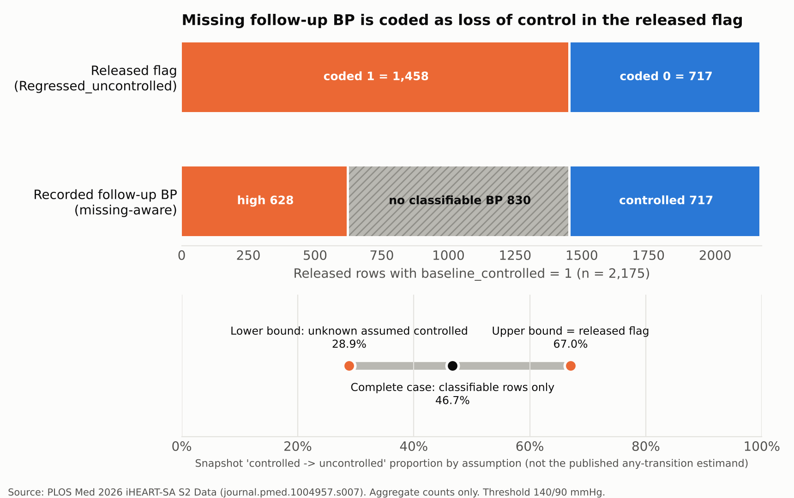

# Hypertension released-outcome audit (R05)

Investigator: Isaac Omoding · Research programme R05 · Stage: **CONDITIONAL — narrow released-data audit** (not a clinical prediction study; not submission-ready)

A September 2026 PLOS Medicine article (Gumede et al., doi:[10.1371/journal.pmed.1004957](https://doi.org/10.1371/journal.pmed.1004957)) reports how adults with and without HIV in nine Johannesburg clinics move along the hypertension care cascade, including "regression" from controlled to uncontrolled blood pressure. Its minimal dataset and Stata code are public. This repository asks what those released snapshot variables can and cannot establish: measured high BP, measured control, missing follow-up, and the article's longitudinal *any-transition* outcome.

## What was checked (17 Oct 2026)

- Downloaded the dictionary, Stata do-file (PDF) and released CSV (25,128 rows × 35 columns) from PLOS; SHA256 in [`data/manifest.json`](data/manifest.json).
- Re-expressed Stata's comparison rule (missing numeric > any number) and reproduced all four released control/transition flags **row for row, 0 disagreements**.
- Among 2,175 rows flagged controlled at baseline: **628** measured high at follow-up, **717** measured controlled, **830** with no classifiable follow-up BP. The released `Regressed_uncontrolled` codes those 830 as loss of control (1,458 = 628 + 830).



## What this does and does not show

- The released flag is the worst-case bound (67.0%); the measured-only lower bound is 28.9%; complete-case 46.7%. These describe the **released two-snapshot flag**, not the published estimand.
- The article's own Fig 3 counts (684 of 3,266 controlled → uncontrolled) do **not** come from the released flags. They appear to be computed from person-visit data that the release omits. So this audit **does not** show that the published estimates were affected, and it makes no claim that they are wrong.
- The published sample (23,855) is not reproduced by the release (22,973 with completed file review); neither HIV field reproduces 18,720 / 5,135; the two HIV fields disagree for 2,065 rows.
- No participant, clinic or visit keys are released, so the any-transition outcome and cluster-robust adjusted risk ratios are **NOT REPRODUCIBLE FROM PUBLIC RELEASE**.
- Also found: age 39 falls outside every `agecat_collapsed` category (912 rows); the released age-category text labels are mismatched because one Stata value label was overwritten.

Full matrix: [`docs/RECONCILIATION.md`](docs/RECONCILIATION.md) · limits: [`docs/LIMITATIONS.md`](docs/LIMITATIONS.md) · status: [`docs/STATUS.md`](docs/STATUS.md).

## Reproduce

```bash
pip install pandas numpy matplotlib openpyxl pytest
PYTHONPATH=src python -m htn_audit.acquire .
PYTHONPATH=src OMP_NUM_THREADS=2 python scripts/run_audit.py
python -m pytest -q   # 15 passed at this checkpoint
```

Raw files stay in git-ignored `data/raw/`; committed outputs are aggregate counts only. No dashboard is deployed.

## Next step

Investigator review of `docs/RECONCILIATION.md`. At most, it supports a brief, neutral reproducibility note asking for clarification of the release (sample filter, HIV field, follow-up missing-value handling). Authors have not been contacted, and nothing will be published externally without investigator approval.

Source data: Gumede SB et al., PLOS Medicine 2026, CC BY 4.0. AI assistance: analysis code and documentation drafted with Claude Code under investigator direction.
